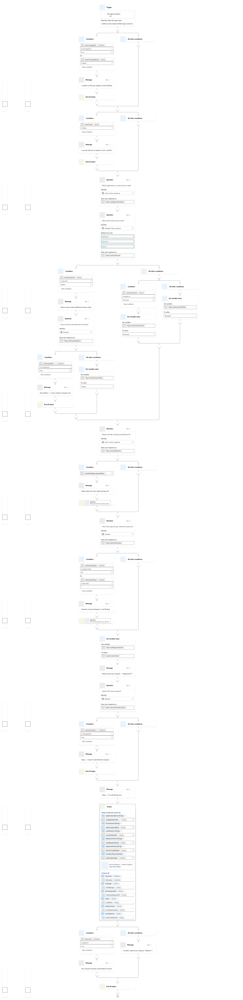
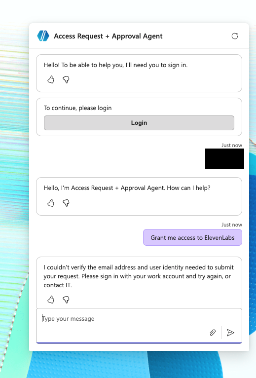

# Access Request Agent (Internal Auth / Secure)

## Purpose

**Access Request Agent (Internal Auth / Secure)**, also referred to as **Access Request (Secure)**, demonstrates the authenticated enterprise-aligned variant of the Access Request & Approval Agent.

The secure variant keeps the same request lifecycle as the public agent but strengthens requester identity capture.

## Identity Pattern

The secure variant uses Entra ID authentication so requester identity can be captured from signed-in context where available.

Relevant Dataverse fields:

- RequestorEmail
- RequestorAadObjectId

This avoids relying only on user-typed requester details and creates a stronger audit trail for access request review.

## Behaviour

The secure agent still collects:

- ApplicationName
- AccessLevel
- Justification
- DurationDays

The updated topic supplies signed-in principal name through the existing `ApproverEmail` input for the manager lookup path, rather than asking the requester to type an approver.

The updated topic uses authenticated context and stops when required identity claims are missing; see the evidence below.

## Why This Matters

Secure identity capture supports:

- Better traceability
- Stronger audit evidence
- Reduced impersonation risk
- More enterprise-aligned request intake

This is still a portfolio/demo project. Production deployment would require additional security review, policy validation, DLP configuration, monitoring, and integration with approved provisioning systems.

## Public Documentation Safety

Do not publish app registration details, client IDs, client secrets, tenant IDs, redirect URLs containing private values, environment URLs, authentication configuration secrets, or screenshots that expose personal maker account details.

## Updated Signed-in Intake Evidence

The updated secure Request Access topic checks `User.IsLoggedIn`, `User.PrincipalName`, and `User.Email` before intake. Missing identity claims lead to a message and topic termination. It sets requester email from `System.User.Email`; the action mapping passes `User.PrincipalName` into the existing `ApproverEmail` input. That input name should not be read as proof that the user selected an approver: the updated Create Request canvas includes `Get manager (V2)` and a manager-email availability branch. The lookup parameters and row field mappings are collapsed, so their exact expressions are not evidenced here. `RequestorAadObjectId` remains part of the wider secure design, but is not visible in this six-input topic call.

Configuration evidence: identity checks, Admin acknowledgement, justification and duration validation, confirmation, and success/failure branches. This is not an end-to-end test result.

Observed refusal after sign-in when the required email/user identity could not be verified. The sign-in code is redacted.
