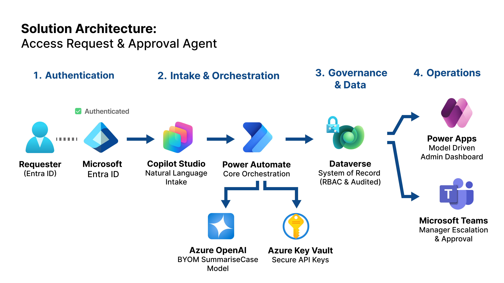

# Architecture

The **Access Request & Approval Agent** demonstrates a governed Power Platform architecture for access request intake and approval.

Copilot Studio provides the conversational front end. Power Automate handles deterministic lifecycle orchestration. Dataverse stores the authoritative record. Teams Adaptive Cards capture human approval. Azure OpenAI BYOM generates CaseSummary as reviewer support. The model-driven app gives operational visibility.

## High-Level Flow

```text
Requester -> Copilot Studio -> Flow A — Create Request -> Dataverse Access Requests
                                  |                          |
                                  v                          +-> Flow B — Approval Watcher
                           Flow H — SummariseCase                 -> Teams decision -> Dataverse
                                                             +-> Flow C — Resolution Watcher
                                                                  -> Simulated fulfilment / closure -> Dataverse
Scheduled Flow D — SLA Reminder / Escalation Watcher <-> Dataverse
Copilot Studio -> GetStatus <-> Dataverse
Model-driven app <-> Dataverse
```

## Why Power Automate Instead Of Agent Flows

Approval, resolution, SLA monitoring, and fulfilment logic are implemented in Power Automate because these lifecycle steps need:

- Deterministic branching
- Retry control
- Run history
- Idempotency
- TRY/CATCH-style error capture
- Dataverse write-back
- Operational supportability

The agent stays focused on intake, validation, acknowledgement, and status lookup.

## Dataverse-Centred Design

The Access Requests table is the system of record. It stores request details, Status, Status Reason, approval fields, CaseSummary, CorrelationId, ResolvedOn, fulfilment fields, reminder fields, escalation fields, error fields, and metrics.

Watcher flows use Dataverse state to decide what should happen next. This makes the lifecycle inspectable through the model-driven app rather than hidden in chat history.

## Public And Secure Modes

| Mode | Purpose | Identity Pattern |
|---|---|---|
| Access Request Agent (Public) | Low-friction public portfolio demo | Requester and approver emails are conversational demo inputs |
| Access Request Agent (Internal Auth / Secure) | Enterprise-aligned authenticated pattern | Signed-in email and principal name are validated; Flow A contains manager lookup |

The [secure topic](../agents/secure-agent.md) stops on missing required identity claims and maps principal name into the existing `ApproverEmail` flow input. [Flow A](../flows/flow-a-create-request.md) shows manager lookup before creation; exact lookup and row mappings remain to verify. `RequestorAadObjectId` capture is not shown in the six-input topic call. The documented public/demo contract needs separate verification against the current flow.

[GetStatus](../flows/flow-get-status.md) has captured allowed and generic denied responses, but its server-side ownership predicate remains unverified. [Flow D](../flows/flow-d-sla-watcher.md) has per-request and outer error scopes; continuation after item failures is a verification goal, not a demonstrated guarantee.

## AI Summarisation Layer

Flow H — SummariseCase uses a BYOM Azure OpenAI pattern to generate CaseSummary.

The summary helps the approver review context. It does not approve, reject, risk-score, or provision access. If the AI call fails, the request should continue with a deterministic fallback summary.

## Operational Visibility

The model-driven app surfaces:

- Current request status
- Approval decisions and comments
- CaseSummary and CorrelationId
- Mock fulfilment and resolution state
- SLA reminder and escalation fields
- Error capture
- Dataverse audit history
- Operational metrics

## Architecture Diagram



A scalable version is available at [architecture/solution-architecture-access.svg](../architecture/solution-architecture-access.svg).

Architecture diagrams must not include tenant URLs, environment URLs, endpoint URLs, email addresses, IDs, secrets, or private run data.
