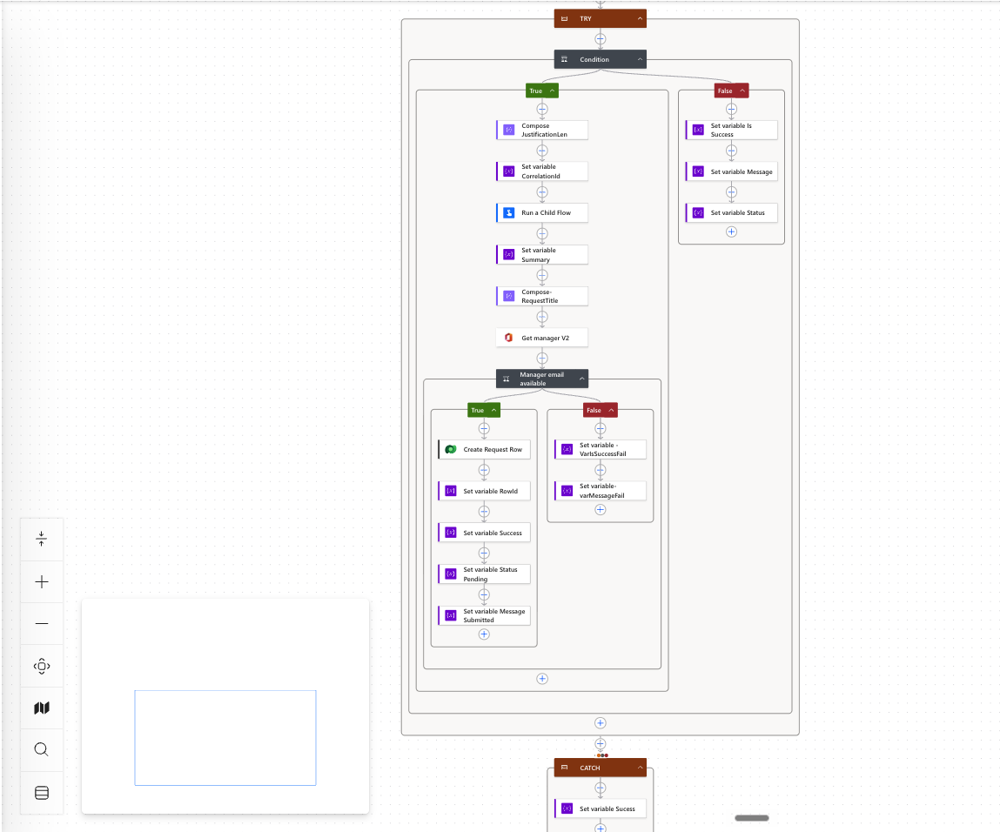
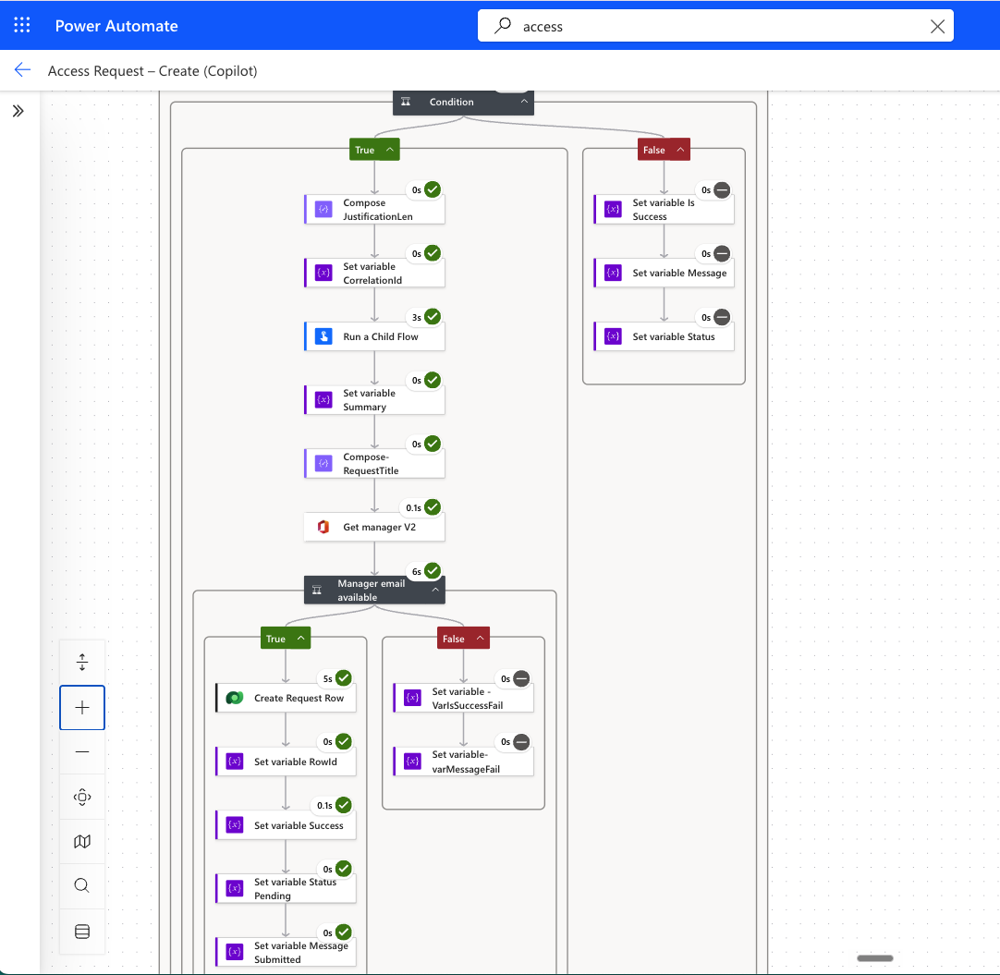
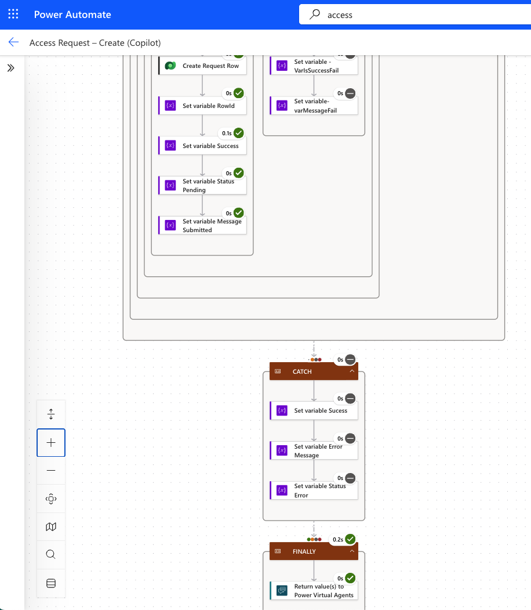
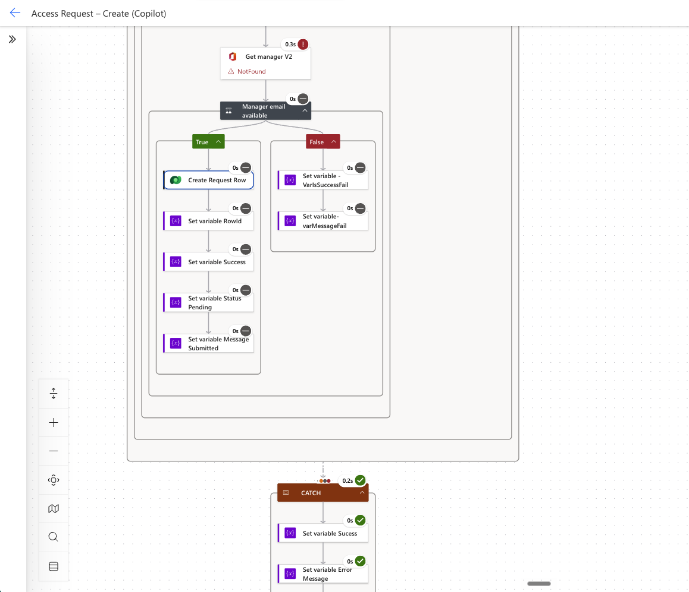
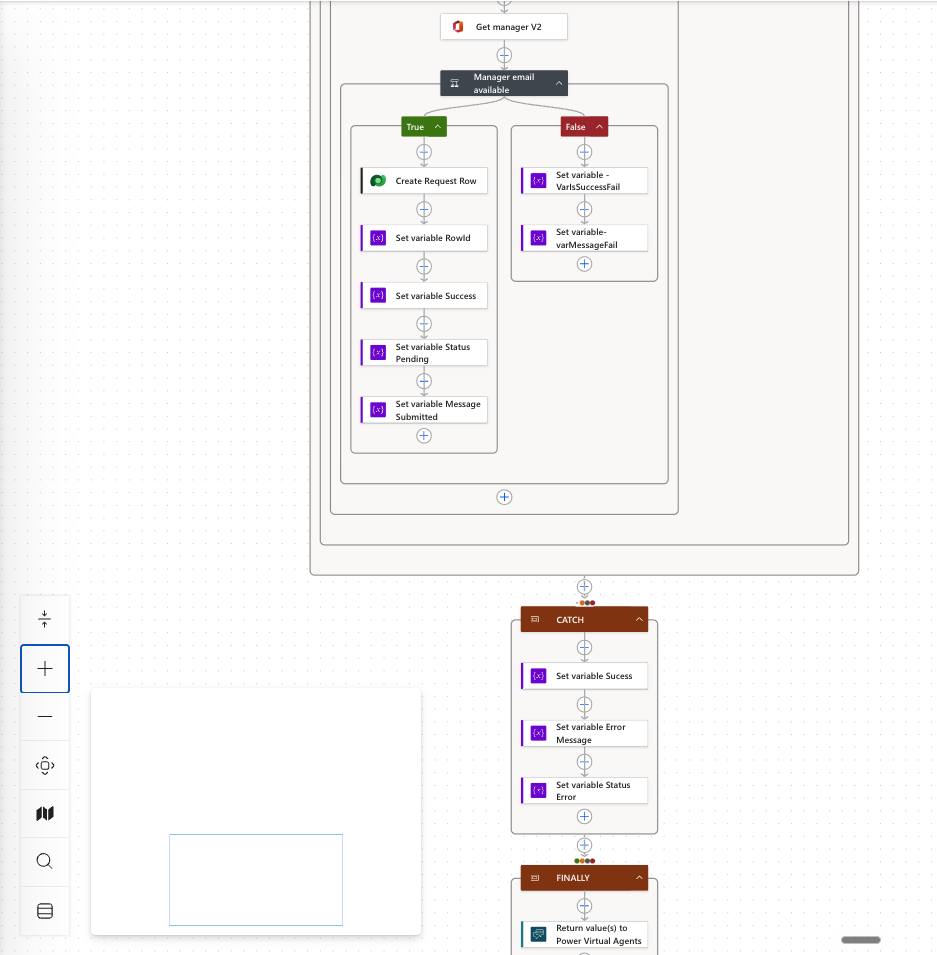

# Flow A — Create Request

## Purpose

Flow A — Create Request is the Copilot-triggered flow that starts the access request lifecycle.

It receives structured input from Copilot Studio, validates the request, generates CorrelationId, calls Flow H — SummariseCase, creates the Access Requests Dataverse row, and returns a structured confirmation to the agent.

## Trigger

Called from Copilot Studio by the Request Access topic.

## Inputs From Copilot Studio

- ApplicationName
- AccessLevel
- Justification
- DurationDays
- RequestorEmail / UPN
- RequestorAadObjectId where available in the secure variant
- ApproverEmail

## Key Logic

1. Validate required inputs.
2. Generate CorrelationId.
3. Call Flow H — SummariseCase.
4. Use the returned CaseSummary or fallback summary.
5. Create the Dataverse Access Requests row.
6. Set the initial Status and Status Reason.
7. Return a requester-friendly response to Copilot Studio.

## Dataverse Fields Updated

- Request Number
- RequestName
- Request Title (Primary)
- RequestorEmail
- RequestorAadObjectId
- ApproverEmail
- ApplicationName
- AccessLevel
- Justification
- DurationDays
- Status
- Status Reason
- SubmittedOn
- CaseSummary
- CorrelationId

## Outputs To Copilot Studio

- Request Number or request reference
- Status
- Status Reason where useful
- CaseSummary where appropriate
- CorrelationId where safe to show
- Success or failure message

## Error Handling

Errors should be returned to the agent as safe, user-friendly messages. Technical details should be captured in flow run history or Dataverse error fields where appropriate, not exposed to the requester.

If Flow H — SummariseCase fails, Flow A should continue with a fallback CaseSummary rather than blocking request creation.

## Updated Manager Lookup and Responses

The updated canvas shows a child-flow call, CaseSummary assignment, request-title composition, `Get manager (V2)`, and a manager-email availability condition. Request creation is on the available-manager branch; the alternate branch sets failure variables. The topic passes the signed-in principal name through the legacy `ApproverEmail` input. Collapsed actions do not establish exact lookup parameters, manager email expressions, or Dataverse field mappings.

Configuration view of the updated request creation path.

Green action indicators show the pictured manager lookup and create-row path succeeded in this run; they do not prove approval or real access provisioning.

Continuation of the successful run: CATCH skipped and FINALLY return succeeded.

The lookup reports NotFound, the create branch is skipped, and CATCH executes. This does not prove the manager-email-empty branch ran successfully.

CATCH contains success, error-message and status assignments; FINALLY returns values to the agent. Exact run-after settings and assignment values are not expanded.

## Screenshot Evidence

Available evidence:

- [Flow A — Create Request overview](../screenshots/createFlow1.png)
- [Successful run history](../screenshots/createFlowRunHistorySuccess.png)

Still needed for deeper verification: expanded trigger/input validation, manager lookup parameters, Dataverse field mappings, CorrelationId expression, and fallback configuration.
