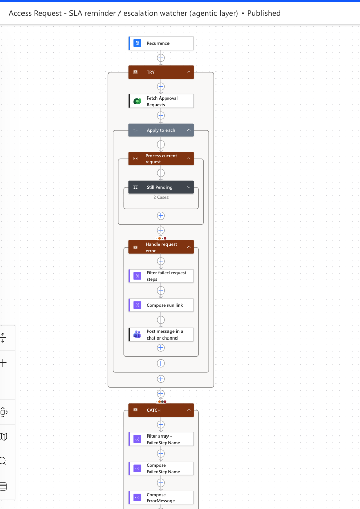
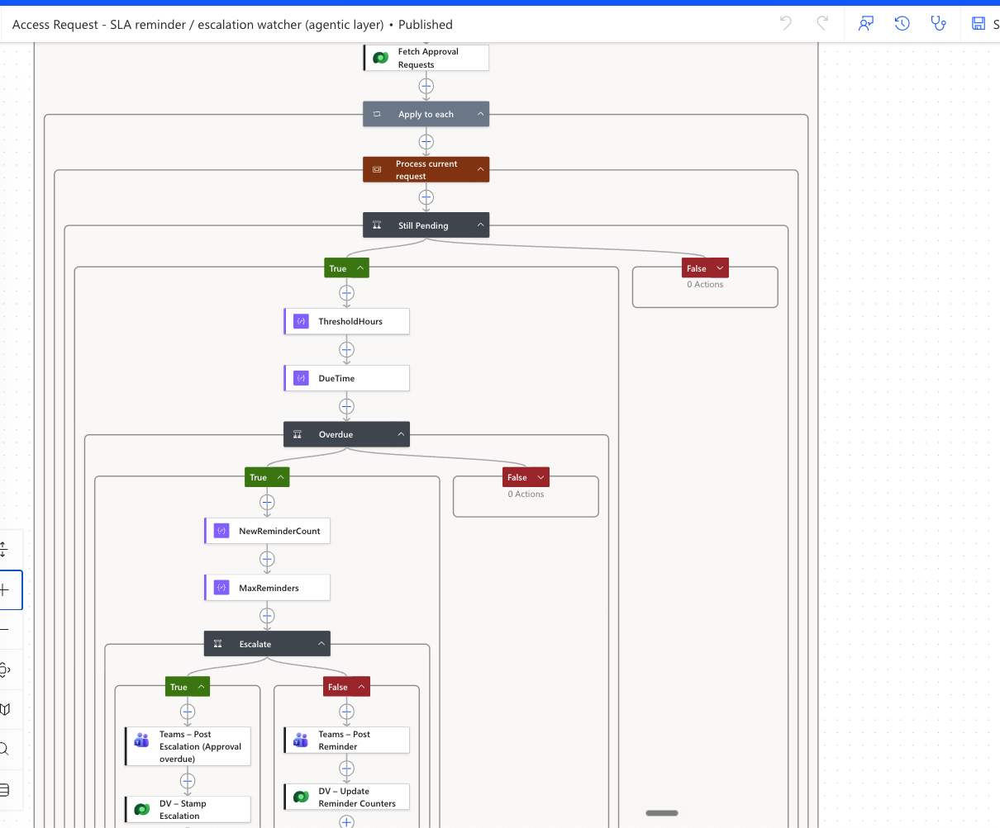

# Flow D — SLA Reminder / Escalation Watcher

## Purpose

Flow D — SLA Reminder / Escalation Watcher monitors pending approvals so requests do not silently stall.

It demonstrates autonomous operational monitoring after the requester has left the chat experience.

## Trigger

Scheduled recurrence, usually daily or aligned to demo needs.

## Configuration

Use environment variables or other safe configuration patterns for:

- SLA reminder threshold
- Maximum reminders
- Escalation recipient
- Approval routing destination

Do not hardcode or publish real recipients, channel IDs, tenant values, or endpoint URLs.

## Key Dataverse Fields Read

- Status
- Status Reason
- ApprovalRequestSent
- ApprovalRequestSentOn
- DecisionOn
- ApproverEmail
- ReminderCount
- LastReminderOn
- Escalated
- EscalationCount
- EscalatedOn

## Key Dataverse Fields Updated

- ReminderCount
- LastReminderOn
- Escalated
- EscalationCount
- EscalatedOn

## Reminder Pattern

1. Find pending requests where approval was sent and no decision has been returned.
2. Compare ApprovalRequestSentOn and LastReminderOn against the configured SLA threshold.
3. Send a reminder where appropriate.
4. Increment ReminderCount.
5. Stamp LastReminderOn.

## Escalation Pattern

1. Check whether ReminderCount has reached the configured limit.
2. Set Escalated.
3. Increment EscalationCount.
4. Stamp EscalatedOn.
5. Avoid repeated uncontrolled escalation of the same request.

## Error Handling

The watcher should handle item-level failures where possible so one problematic record does not break the entire scheduled sweep.

Where implemented, item errors should be captured on the request row or in an operational log.

## Updated Reminder and Error-Handling Configuration

Recurrence enters TRY, fetches approval requests, and processes each request with a Still Pending condition. The per-request error scope filters failed steps, composes a run link and contains a Teams message action. An outer CATCH filters and composes failure details. Destinations, expressions and run-after settings are collapsed; this configuration image does not prove notification delivery or that all item failures allow the sweep to continue.

The expanded canvas shows ThresholdHours, DueTime, Overdue, NewReminderCount, MaxReminders, and Escalate. The two branches contain Teams escalation/reminder actions and Dataverse stamp/update actions. Expanded counter expressions and row updates are still needed to verify the exact write-back semantics.

## Screenshot Evidence

Available evidence:

- [Maximum reminders gate](../screenshots/slaMaxRemindersGate.png)
- [Earlier failed TRY with successful CATCH run](../screenshots/slaTryFailCatchSuccess.png)
- [Teams approval reminder](../screenshots/teamsApprovalReminder.png)

Still needed: expanded overdue query, recurrence schedule, counter/timestamp expressions, run-after settings, and runtime evidence for both reminder and escalation branches. The older TRY/CATCH run remains a separate example, not a test result for this updated configuration.
