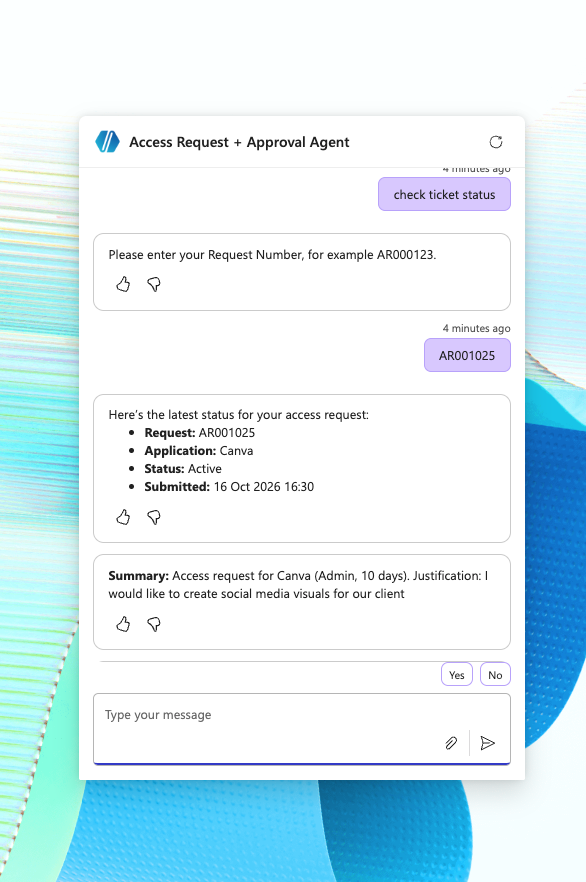
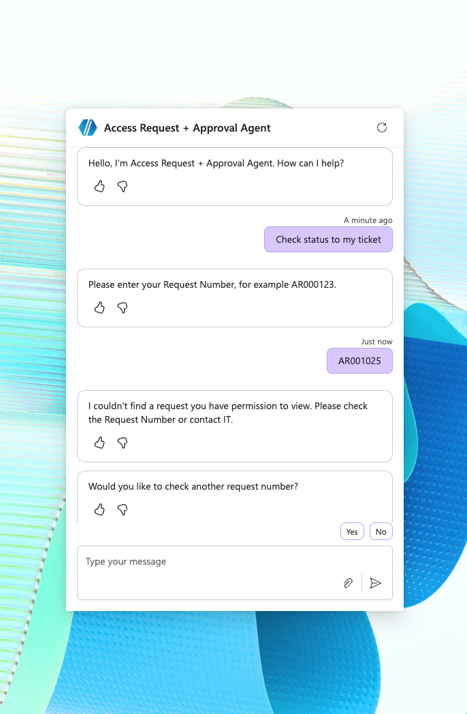
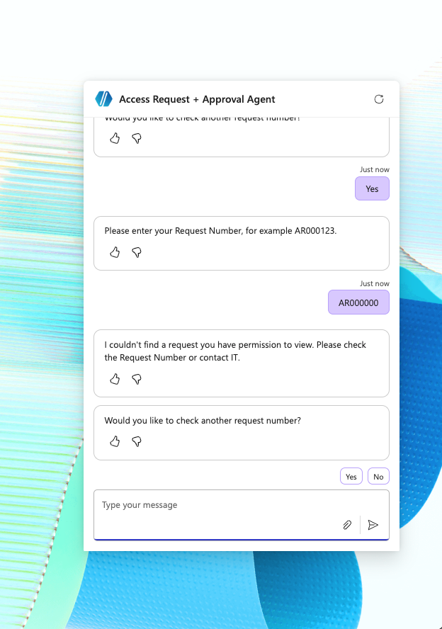

# GetStatus

## Purpose

GetStatus is a Copilot-triggered helper flow that returns the current lifecycle state of an access request from Dataverse.

It gives requesters a structured status-check path without relying on chat memory or Teams messages.

## Trigger

Called from Copilot Studio by the GetStatus or Check Request Status topic.

## Inputs

- Request Number or request identifier
- RequestorEmail / UPN where needed for lookup or filtering

## Dataverse Lookup

The flow retrieves the matching Access Requests row and returns requester-safe lifecycle information.

## Outputs

- Status
- Status Reason
- SubmittedOn
- DecisionOn where available
- ResolvedOn where available
- ApproverDecision where available
- CaseSummary where appropriate
- Request not found message where appropriate
- Next-step message for the requester

## Governance Notes

- Dataverse remains the system of record.
- Updated conversation evidence demonstrates different allowed and denied responses; the exact flow-side ownership predicate is not visible. Production review should verify trusted identity binding and server-side enforcement.
- Responses should avoid exposing internal-only error fields or private operational details.

## Screenshot Evidence

Available evidence:

- [GetStatus flow](../screenshots/getStatus.png)
- [Check Access Status topic — full flow](../screenshots/copilotTopicCheckAccessStatusFullFlow.png)

Expanded authorization configuration and controlled identity test evidence remain to capture (redacted).

## Observed Status Responses

AR001025 returns application, displayed Status `Active`, submitted timestamp and summary. `Active` is the displayed status in this response, not proof that access was provisioned or a new approval lifecycle state.

A separate conversation using AR001025 receives “I couldn't find a request you have permission to view.” This supports an ownership-aware user experience, but the screenshots do not show which identities were used or the underlying ownership expression.

AR000000 receives the same generic response and an option to check another number. It does not reveal whether a request exists. The older flow and topic canvases above remain useful structural evidence; they do not establish the updated authorization implementation. An expanded GetStatus lookup/filter and controlled two-user test are still needed to verify enforcement.
